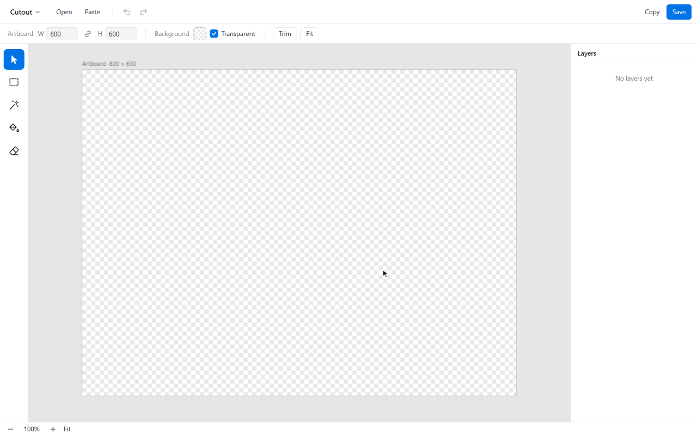
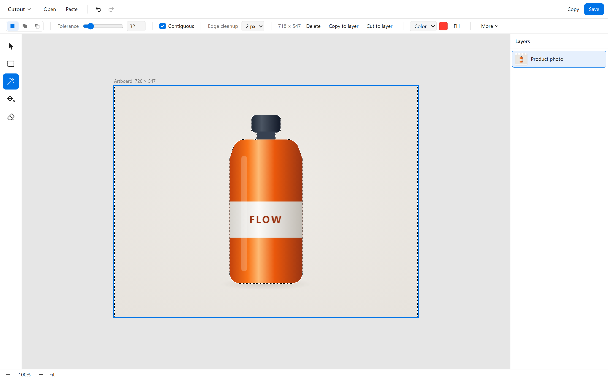
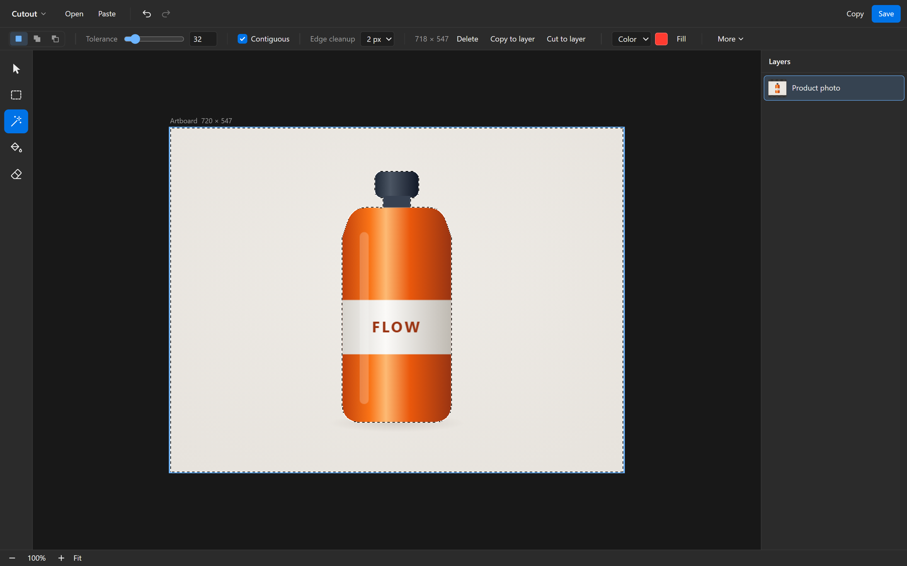

# Cutout

[](https://github.com/cutout-design/cutout/releases/latest)
[](https://github.com/cutout-design/cutout/actions/workflows/tests.yml)
[](LICENSE)

A lightweight raster scratchpad for designers.

Cutout handles the quick bitmap fixes that come up while designing in Figma: cut out a background, pull part of an image onto its own layer, fill, erase, scale, line things up, then copy the result back to Figma or save it as PNG or JPEG. It works like Fireworks and Sketch (select things directly, move them directly) and stays deliberately small: no project files, no Photoshop-style complexity. Paste, fix, copy back.

Cut out a product photo: paste it, click the background with the magic wand, press Delete, copy it back.



Remove a notification from a screenshot: draw a marquee around it, Smart fill it (Shift+Backspace), copy it back.


<p>


</p>

Available as a desktop app for **Windows** (x64 and ARM64) and **Mac (Apple Silicon)**, and as a web page in any Chromium browser. Website: [cutout.design](https://cutout.design).

## Install

Download the latest version from [Releases](../../releases).

**Windows**: run `Cutout-<version>.exe` on most PCs (Intel or AMD), or `Cutout-<version>-arm64.exe` on Windows on ARM (for example Snapdragon laptops). Not sure? Settings → System → About → System type says "x64-based" or "ARM-based". It installs for your user account only (no administrator rights needed) and adds Cutout to the Start menu, the desktop, and the "Open with" menu for images. Your default image viewer stays the same. From the release after 1.3.5, the installer is code-signed, so Windows shows who published it. A newly signed app can still get a "Windows protected your PC" warning for a while: choose **More info → Run anyway**. Versions up to 1.3.5 aren't signed and show that warning every time.

**Mac (Apple Silicon)**: unzip `Cutout-<version>.zip` and move **Cutout.app** to Applications. From the release after 1.3.5, the app is signed and notarized by Apple: the first time, macOS only asks whether to open an app downloaded from the Internet, so click **Open**. Versions up to 1.3.5 aren't signed: macOS says it "could not verify" Cutout, so click **Done**, then go to **System Settings → Privacy & Security**, click **Open Anyway** next to the Cutout message, and confirm (once per version). Cutout appears in Finder's **Open With** menu for images; Preview stays the default.

**Web version**: use it at [app.cutout.design](https://app.cutout.design) (always the latest release), or open `cutout/index.html` from the source in Chrome or Edge. Everything works except reading the clipboard on its own (Ctrl+V still works), Open with, and the native save dialog.

## What it does

- **Paste from Figma**: a normal Ctrl+C in Figma pastes as an image at 1×, drawn by Cutout itself (no Figma account or plugin needed). Copy as PNG and Copy as SVG work too. Also open files, drag them in, or use "Open with".
- **Cut out backgrounds**: magic wand with live tolerance (drag to adjust, like Sketch), contiguous or global, and edge cleanup that removes color halos.
- **Select pixels**: marquee (free, fixed aspect ratio, or exact size), add and subtract, invert, grow or shrink one side by 1 px, and Shrink to content: draw a loose marquee around something on a plain background (a scan, a button in a screenshot) and the selection snaps to it. For scans, Straighten levels a crooked card or page and Clear corners removes the paper in a card's rounded corners.
- **Work with selections**: copy or cut to a new layer, delete, fill with a color, or Smart fill to remove things (the background, a gradient or a texture continues through), save just the selection, trim the artboard to it. With a selection, right-click anywhere for its menu.
- **Paint and erase**: paint bucket with tolerance, eraser with adjustable size, fill color picked from anywhere on screen.
- **Layers**: move, duplicate (Alt+drag), rename, reorder, hide, flip, rotate 90°, and drag a layer out as a PNG file into Figma, Explorer or Finder.
- **Lossless scaling**: handles and W/H fields; layers keep their original pixels until edited, and "Original size" brings them back.
- **Align and space** like Figma: align and distribute with Figma's shortcuts, smart guides, equal-spacing snapping, and spacing handles for rows and columns.
- **Artboard**: canvas size with anchor, image size, trim to content, fit to layers, background color or transparent.
- **Copy and save**: copy a selection, layers, or the whole artboard as PNG; save as PNG or JPEG (with quality), with silent re-save after the first time.
- **Comfort**: math in every number field (`60/2`, `*2`, `50%`), light and dark themes, Mac-native shortcuts and menu bar on a Mac.

Everything is explained in the **[user guide](docs/user-guide.md)**, including every shortcut.

## Privacy

Cutout works entirely on your computer. There's no account, no analytics, and nothing you open, paste or make is uploaded anywhere.

Cutout goes online only twice. When you paste a normal Figma copy that contains images, the copy holds links to those images on Figma's servers, and Cutout downloads them to draw the paste, the same way Figma does. And the desktop app checks GitHub for a new version once a day (and when you choose Check for Updates). Nothing about you is sent with either request.

Your settings (theme, tolerances and so on) stay on your computer. Dragging a layer out writes a temporary PNG file, which Cutout deletes again.

The full privacy policy, including the website and the browser version, is at [cutout.design/privacy](https://cutout.design/privacy/).

## Build from source

Requires [Node.js](https://nodejs.org/) (LTS).

```bash
npm install
npm start          # run the desktop app from source
npm run dist       # Windows installer, x64 (on Windows) → dist/
npm run dist:arm64 # Windows installer, ARM64 (on Windows) → dist/
npm run dist:mac   # Mac app (on a Mac) → dist/
npm test           # run the tests (starts Cutout and drives it)
```

The app itself is plain HTML, CSS and JavaScript in `cutout/`, with no build step. The desktop app uses Electron (`main.js`, `preload.js`). The tests in `tests/` start Cutout and use it like a person would (clicks, keys, pastes) on made-up images; GitHub Actions runs them on every change. Releases are built automatically when a version tag is pushed; see `CHANGELOG.md` for what changed in each version. To report a bug, suggest an idea or send a change, see [CONTRIBUTING.md](CONTRIBUTING.md). To report a security problem, see [SECURITY.md](SECURITY.md).

## License

Cutout is free and open source under the [MIT license](LICENSE).

## Third-party code

- [fzstd](https://github.com/101arrowz/fzstd) by Arjun Barrett (MIT) and [kiwi](https://github.com/evanw/kiwi) by Evan Wallace (MIT), in `cutout/vendor/`, decode Figma copies. Their license notices are at the top of each file.
- The desktop app is built on [Electron](https://www.electronjs.org/) (MIT); its own and Chromium's licenses ship with the app.
