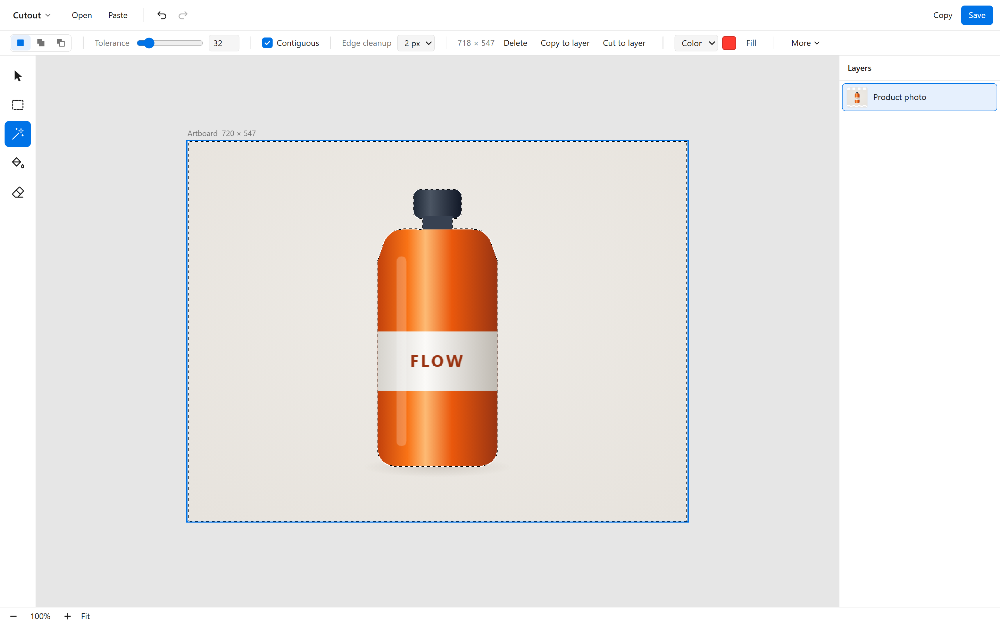
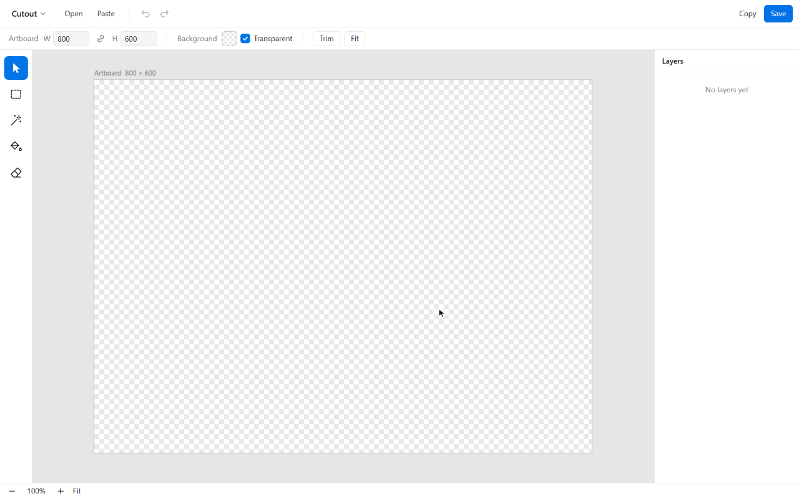

# Cutout user guide

Cutout is a small raster editor for the quick bitmap fixes that come up while designing in Figma: cut out a background, copy part of an image to its own layer, fill, erase, scale, line things up, and send the result back to Figma or save it as PNG or JPEG.

It works the way Fireworks and Sketch do: you select things directly and move them directly. There are no project files. Cutout is a scratchpad: paste, fix, copy back.

**Shortcuts in this guide are written for Windows.** On a Mac, read Ctrl as ⌘ (Command) and Alt as ⌥ (Option). Cutout shows the Mac symbols in its own menus and tooltips on a Mac.

## Contents

1. [The window](#the-window)
2. [Getting images in](#getting-images-in)
3. [Moving around](#moving-around)
4. [The artboard](#the-artboard)
5. [Layers](#layers)
6. [Pointer tool](#pointer-tool-v)
7. [Selecting pixels](#selecting-pixels)
8. [Marquee tool](#marquee-tool-m)
9. [Magic wand](#magic-wand-w)
10. [Working with a pixel selection](#working-with-a-pixel-selection)
11. [Paint bucket](#paint-bucket-g)
12. [Eraser](#eraser-e)
13. [Fill color and the eyedropper](#fill-color-and-the-eyedropper)
14. [Aligning and spacing](#aligning-and-spacing)
15. [Scaling, flipping and rotating](#scaling-flipping-and-rotating)
16. [Copying and getting images out](#copying-and-getting-images-out)
17. [Saving](#saving)
18. [Number fields](#number-fields)
19. [Settings](#settings)
20. [Desktop app and web version](#desktop-app-and-web-version)
21. [Keyboard shortcuts](#keyboard-shortcuts)
22. [Using Cutout without a mouse](#using-cutout-without-a-mouse)
23. [Tips and recipes](#tips-and-recipes)

## The window

- **Top bar**: the Cutout menu (settings and About), Open, Paste (desktop app), Undo and Redo, Copy, and Save.
- **Options bar** (below the top bar): settings for the current tool, then controls for whatever is selected: the artboard, a layer, several layers, or a pixel selection. It changes as you work.
- **Toolbar** (left): Pointer, Marquee, Magic wand, Paint bucket, Eraser.
- **Canvas** (center): the artboard and its layers on a neutral background. A checkerboard shows transparency.
- **Layers panel** (right): every layer, top layer first.
- **Status bar** (bottom): zoom controls, the pixel position under the cursor, and the color under the cursor (hex value, plus opacity if it isn't fully opaque, or "transparent").

Right-click anywhere on the canvas for a menu that fits what's under the cursor: a pixel selection, a layer, the artboard, or empty space.

## Getting images in

**Paste** (Ctrl+V) is the main way in.

- **From Figma, a normal copy** (Ctrl+C in Figma): Cutout draws the copied layers itself and pastes them as one image at 1×, the same size they have in Figma. Several selected layers become one image, like Figma's Copy as PNG. Image fills are downloaded from Figma, so a copy with photos needs an internet connection. Most of Figma is drawn exactly: shapes, rounded and smooth corners, booleans, gradients, pattern fills, images and GIFs (first frame), text and text on a path (no fonts needed), arrows and other line ends, shadows, blurs, blend modes, masks, components (including variants, component properties and slots), variables (including Light/Dark and other modes set on the copied layers; a mode set on a parent frame or the page isn't in the copy, so the default mode is used), and FigJam boards (stickies, shapes, connectors and their labels, sections, tables, code blocks, marker and highlighter, stamps, stickers and widgets). If something can't be drawn exactly, Cutout pastes nothing and asks you to use Copy as PNG. That includes emoji, wavy or dotted underlines, brushes, noise, texture and glass effects, progressive blur, image adjustments other than lowering saturation, video fills, dashed partial circles (arcs), empty sticky notes (Figma shows placeholder text in them), washi tape, and Figma Sites webpages (frames copied from Sites paste fine). It also happens when the images can't be downloaded, and with any Figma feature newer than your version of Cutout.
- **Copy as PNG** (Ctrl+Shift+C in Figma) always works and is pixel-exact. Figma copies at 2×, so the image comes in at double size; use the W/H fields or Image size… to halve it.
- **Copy as SVG** from Figma also works: Cutout renders the SVG at 1×.
- Something you **copied in Cutout** pastes back exactly where it came from.

Other ways in:

- **Open** (Ctrl+O): pick one or more image files.
- **New** (Ctrl+N, desktop app): start over with an empty document, like Select all and Delete in one step. Undo brings the previous one back.
- **Drag files** from Explorer, Finder or the desktop onto the canvas. They land where you drop them.
- **Open with** (desktop app): right-click an image file and choose Open with → Cutout. If Cutout is already open, the image is added as a new layer.

Supported: PNG, JPEG, GIF, WebP, SVG and anything else the system can decode.

How images are placed:

- The **first image** in an empty document sets the artboard to its size, sits at the top-left, and gives the document its name (used when saving).
- Later images are placed in the **center of the view** as new layers, above the selected layer.

## Moving around

- **Pan**: scroll (two-finger scroll on a trackpad), Shift+scroll to pan sideways, hold **Space** and drag, or drag with the middle mouse button.
- **Auto-scroll**: while you drag a marquee, move layers or drag a selection box around layers, bring the pointer to the edge of the canvas (or past it) and the view scrolls that way, faster the further out you go. Hold the pointer still and it keeps going until the artboard's edge comes into view.
- **Zoom**: Ctrl+scroll or pinch, zooming toward the cursor. Or use Ctrl+= and Ctrl+−, the − and + buttons in the status bar, or Ctrl+0 to fit the artboard in the window (also the **Fit** button). Ctrl+1, or clicking the zoom percentage, goes to 100%.

There's no Hand tool on purpose: Space and scrolling are always available, whatever tool you're using.

## The artboard

The artboard is the document: what you save and what "Copy artboard" copies. Layers can extend past it; anything outside is kept but not saved.

**Select the artboard** by clicking an empty part of it with the Pointer, or its name label above the top-left corner. Then:

- **Drag its edges or corners** to change the canvas size. Dragging the left or top edge adds or removes space on that side, and the content stays where it is on screen.
- The **options bar** shows the artboard settings (with the Pointer tool and nothing else selected):
  - **W and H**: canvas size. The image isn't scaled; space is added or removed at the right and bottom. The link button keeps the proportions.
  - **Background**: a color, or **Transparent**. JPEG files get the background color, or white if transparent.
  - **Trim**: shrinks the artboard to the visible pixels on it, and clips layers that hang outside.
  - **Fit**: resizes the artboard to fit all visible layers.

**Right-click the artboard** for:

- **Copy artboard** (everything on it, as one image)
- Paste (desktop app)
- Save and Save as
- **Canvas size…** (Ctrl+Alt+C): set width and height, choose an **anchor** (which side the space is added to or removed from), and the background.
- **Image size…** (Ctrl+Alt+I): scales the artboard and everything on it. Keep proportions is on by default, and the dialog shows the percentage. Layers keep their original pixels, so scaling down and back up loses nothing.
- **Trim to content** (Ctrl+Alt+T) and **Fit to layers** (Ctrl+Alt+F)

Other ways to set the artboard: **Trim to selection** (pixel selection menu) and **Fit artboard to layer** (layer menu).

## Layers

Every pasted or opened image is a layer. The Layers panel lists them top first.

- **Select**: click a row. Shift+click or Ctrl+click adds or removes a layer from the selection.
- **Show or hide**: the eye on each row.
- **Rename**: double-click the name, press F2, or right-click → Rename. Enter keeps the name, Esc cancels.
- **Reorder**: drag rows up or down. Or use Ctrl+] / Ctrl+[ (forward / backward) and Ctrl+Shift+] / Ctrl+Shift+[ (to front / to back).
- **Delete**: the Delete key, or Delete in the right-click menu.
- **Drag a row out of Cutout** to save that layer as a PNG file: onto the desktop, into a folder, or into Figma.
- Hover over a row to see the layer's size and position.

**Right-click a layer** (on the canvas or in the panel; on the canvas only while there is no pixel selection, since then right-click shows the selection menu) for: Copy, Cut, Duplicate, Rename, Delete, Edit pixels, Original size, Flip horizontal, Flip vertical, Rotate 90° right or left, Straighten, Shrink to content, Clear corners, Save layer as…, Fit artboard to layer, the four arrange commands, and Show or Hide.

Layers that become completely empty (all pixels erased or cut away) are removed automatically. Layers trim themselves to their visible pixels after edits, so a layer's box always fits its content.

## Pointer tool (V)

The Pointer selects and moves layers.

- **Click** a layer to select it. Cutout picks the topmost layer with a visible pixel under the cursor, so clicking a transparent area selects what's behind it. Hovering shows an outline of the layer you'd select.
- **Shift+click** adds or removes layers from the selection.
- **Drag on an empty area** to select every layer the box touches (Shift+drag adds to the selection).
- **Click empty space** to deselect. A click on an empty part of the artboard selects the artboard.
- **Drag** a layer to move it. With several layers selected, they move together.
  - **Shift** while dragging: move only horizontally or vertically.
  - **Alt+drag**: drag a copy and leave the original in place.
  - **Smart guides** snap the edges and centers of what you move to other layers and to the artboard, and show the alignment as a line. Pink markers show when the spacing matches a gap that already exists between other layers.
  - Hold **Ctrl** while dragging to turn snapping off.
- **Arrow keys** move the selected layers 1 px, **Shift+arrow** 10 px. Rapid nudges count as one undo step.
- **Double-click** a layer to edit its pixels: Cutout switches to the Marquee tool for that layer. Press **Esc** to go back to the Pointer.

With one layer selected, the options bar shows **X, Y, W, H** (see [Scaling](#scaling-flipping-and-rotating)). With two or more, it shows the [alignment](#aligning-and-spacing) controls.

## Selecting pixels

The Marquee and Magic wand create a **pixel selection**, shown with marching ants. Pixel tools always work on one layer, the **active layer**: the one you clicked or last selected. Picking another layer in the Layers panel keeps the selection, so you can select an area and then choose which layer to work on (as in Fireworks). Clicking another layer on the canvas with the Pointer selects that layer and clears the pixel selection. Pixel commands (Delete, Fill, Cut to new layer and the like) leave a hidden layer alone and say "The layer is hidden".

Both tools share three selection modes in the options bar:

- **New selection** replaces the current one.
- **Add to selection**, or hold **Shift** while you click or drag.
- **Subtract from selection**, or hold **Alt**.

The mode you pick stays until you change it. Shift and Alt work as temporary overrides.

Selections stay inside the artboard, as in Fireworks: drag past an edge to select right up to it.

## Marquee tool (M)

Drag to select a rectangle. The size shows in the options bar while you drag. To select more than fits in the window, drag to the edge of the canvas: the view scrolls and the selection keeps growing.

Selection shape (options bar):

- **Free**: any rectangle. Hold **Shift** while dragging for a square (in New selection mode).
- **Aspect ratio**: the rectangle keeps the ratio you type (starts at 16:9).
- **Exact size**: click to place a selection of exactly that size (starts at 1200 × 630); drag to position it.

Ctrl+A with the Marquee or Magic wand selects the whole artboard.

## Magic wand (W)

Click a color to select it. Options bar:

- **Tolerance** (0 to 255): how different a color can be and still be included. Changing it updates the current selection live, so you can click once and then adjust.
- **Drag to set tolerance**: click and hold, then drag away from the spot. The farther you drag, the higher the tolerance, and the selection updates as you go (like Sketch).
- **Contiguous**: on, only connected pixels of that color; off, every matching pixel in the layer.
- **Edge cleanup** (Off, 1 to 4 px): removes colored halos. See below.

### Cutting out a background

1. Choose the Magic wand and click the background.
2. Adjust the tolerance if needed (slider, or drag while clicking).
3. Press **Delete**.

When the selection came from clicking a solid background color, Delete also cleans the edges of what's left: pixels along the edge that were blended with the background color get that color removed, so there's no light or dark halo when you place the cutout on another background. **Edge cleanup** sets how many pixels deep this goes (2 px is a good default; Off disables it).

## Working with a pixel selection

To remove something (a notification, a name, a logo), select it with a little margin and press **Shift+Backspace** (Smart fill). Cutout fills the selection from its surroundings, so the background, a gradient or a texture continues through. Check the result: if the selection cuts through other things, the fill can make up shapes that weren't there.

The options bar shows the selection size and these actions; right-clicking anywhere on the canvas while there is a selection shows the same and more (deselect with Esc or Ctrl+D to get the layer menu).

- **Delete** (Delete key): clears the selected pixels in the active layer.
- **Copy to layer** (Ctrl+J): copies the selected pixels into a new layer above, in the same place.
- **Cut to layer** (Ctrl+Shift+J): moves them into a new layer.
- **Fill**: the menu before it sets what Fill uses.
  - **Color** (Alt+Backspace): the fill color. Without an active layer, it creates a new "Fill" layer.
  - **Smart** (Shift+Backspace): fills from the surroundings, copying pixels from around the selection, so flat backgrounds, gradients and textures continue through it. It only reuses pixels from the image, never new ones. Big areas take a few seconds; you can keep working meanwhile.
  - The shortcuts always do the same thing, whatever the menu is set to.
- **Copy** (Ctrl+C) and **Cut** (Ctrl+X): to the clipboard.
- **More** menu:
  - **Invert selection** (Ctrl+Shift+I)
  - **Shrink to content**: the selection snaps to the object inside it. Draw a loose marquee around something on a plain background (a scanned card, a button in a screenshot, an object on transparency), then choose this. The background is read from the selection's edge, so a slightly uneven scan still counts as background; straight lines across the whole selection (a scanner's edge) and specks are ignored. Also in the right-click menu. With no selection, right-click the layer: it finds the object on the whole artboard and selects it.
  - **Straighten**: levels a slightly crooked scan. Cutout finds the object in the selection (as Shrink to content does), measures how much its outline is tilted, and rotates the layer to level it, up to 10°. The corners the rotation exposes are transparent. If the selection came from Shrink to content, it is re-fitted to the leveled object, so a trim afterwards leaves no strip of background. For a scanned card: Shrink to content, Straighten, Trim to selection, Clear corners. Also in the right-click menu, and for a whole layer in the layer's right-click menu.
  - **Clear corners**: makes the paper in a card's rounded corners transparent. Cutout finds the card in the selection (or in the whole layer, for example after Straighten and cropping to the card), measures how round its corners are, and clears only the paper outside that curve, never inside the card, however white it is there. Edge cleanup removes the light fringe. Also in the right-click menu, and in the layer's right-click menu.
  - **Save selection as…**: saves just the selected pixels as a PNG.
  - **Trim to selection**: the artboard becomes the selection's bounds and everything outside it is cut off, like Trim. The view re-fits the new artboard.
  - **Deselect** (Ctrl+D)

Adjusting a selection:

- **Arrow keys** move the selection outline 1 px (Shift: 10 px) while the Marquee or Magic wand is active. A selection moved past the artboard's edge keeps its shape; commands use only the part inside.
- **Ctrl+arrow** grows the selection by 1 px on that side; **Ctrl+Shift+arrow** shrinks it by 1 px from that side. This works for any shape, including wand selections.
- **Esc** clears the selection and returns to the Pointer. (With the Pointer, Esc clears a pixel selection first, then deselects layers.)

## Paint bucket (G)

Click to fill. Options bar: **Fill** with **Color** (and the fill color) or **Smart**, then **Tolerance** and **Contiguous**, like the wand. The bucket keeps its own Fill setting, separate from the selection's, and starts on Color.

- Click a layer: fills the matching color area of that layer.
- With a pixel selection: clicking inside it fills the whole selection.
- With **Smart**, the bucket works only inside a pixel selection (select what to remove first).
- Click an empty part of the artboard: creates a background layer at the bottom, filled with the color.

## Eraser (E)

Drag to erase pixels from the layer under the cursor (or the active layer). A circle shows the brush size.

- **Size**: 1 to 300 px, in the options bar, or **[** and **]** to change it.
- A single click erases one dot.
- With a pixel selection, the eraser only erases inside it.

## Fill color and the eyedropper

The fill color is shared by the Paint bucket and the selection Fill. Click the color swatch in the options bar to choose one.

Press **I** to pick a color from **anywhere on screen**, even outside Cutout (a magnifier appears). It becomes the fill color.

## Aligning and spacing

Select two or more layers with the Pointer. The options bar shows:

- **Align**: left (Alt+A), horizontal centers (Alt+H), right (Alt+D), top (Alt+W), vertical centers (Alt+V), bottom (Alt+S). These are the same shortcuts as Figma. One selected layer aligns to the artboard; several align to their combined bounds.
- **Distribute horizontal spacing** (Alt+Shift+H) and **vertical spacing** (Alt+Shift+V): with three or more layers, makes the gaps equal. The two outermost layers stay put.
- **Spacing field**: when the selected layers form a row or a column, it shows the gap between them ("Mixed" if they differ). Type a value to set every gap at once; the first layer stays put.
- **Spacing handles**: for a selected row or column, pink handles appear in the gaps on the canvas. Drag one to change all the gaps together.

## Scaling, flipping and rotating

Select one layer with the Pointer to get scale handles and the X, Y, W, H fields.

**Handles**:

- **Corner handles** keep the proportions; hold **Shift** to scale freely.
- **Side handles** stretch in one direction; hold **Shift** to keep the proportions.
- Hold **Alt** to scale from the center.
- Edges snap to other layers and the artboard (hold Ctrl to turn snapping off).

**Fields**: X and Y move the layer; W and H resize it. With the link button on, typing one keeps the original proportions. The percentage next to them shows the current scale compared with the original.

**Scaling doesn't lose quality.** Each layer keeps its original pixels while you scale, and the result is always made fresh from them. Scale down, scale back up, and it's as sharp as before. **Original size** (button in the options bar, or right-click) returns to the original pixels. A pixel edit (erase, fill, delete, cut) makes the current size the new original.

**Flip and rotate** (right-click a layer): Flip horizontal (Shift+H), Flip vertical (Shift+V), Rotate 90° right, Rotate 90° left. Each layer turns around its own center. **Straighten** levels a slightly crooked scan (up to 10°) by the tilt of the object on it.

## Copying and getting images out

**Copy** (Ctrl+C, or the Copy button) puts a PNG on the clipboard, ready to paste into Figma or anywhere else. What it copies depends on what's selected:

- **A pixel selection**: those pixels from the active layer (or from everything visible, if the selection isn't on that layer).
- **Layers**: the selected layers, combined into one image.
- **Nothing**: the whole artboard.

**Cut** (Ctrl+X) does the same and removes what it copied.

Other ways out:

- **Drag a layer row** from the Layers panel to the desktop, a folder, or Figma.
- **Save layer as…** and **Save selection as…** (right-click) save one piece as a PNG without changing the document's save location.

Pasting something you copied in Cutout puts it back in its original position.

## Saving

- **Save** (Ctrl+S): the first time, a dialog asks for the format and file name, then the system's save dialog asks where. After that, Ctrl+S saves silently to the same file. When you start over (delete everything, then paste or open another image), Save asks where again, so the earlier file isn't overwritten.
  - **PNG** keeps transparency.
  - **JPEG** has a quality slider (10 to 100). Transparent areas become the artboard background color, or white.
- **Save as** (Ctrl+Shift+S): asks again, for a new file or format.
- What's saved is the **artboard**: everything inside it, at its size.
- If you close Cutout with unsaved changes, it asks first. Nothing else ever asks, by design.

There are no Cutout project files: layers aren't kept after closing. Save the result as PNG or JPEG, or copy it back to Figma.

## Number fields

Every number field (sizes, positions, tolerance, spacing, dialogs) accepts math, like Sketch and Figma:

- `60/2` gives 30, `(100+20)*2` gives 240.
- Start with an operator to change the current value: `*2` doubles it, `/2` halves it, `+10` adds 10.
- `50%` gives 50% of the current value.
- **↑ and ↓** change the value by 1, **Shift+↑/↓** by 10.
- Press Enter or click elsewhere to apply. Something that isn't a number or a formula puts the old value back.

## Settings

Open the **Cutout** menu (top-left):

- **Theme**: System (follows your computer), Light or Dark. In the desktop app, the window's title bar follows it too.
- **Check for Updates** (desktop app): asks GitHub right away whether a new version is out. On the Mac app it's in the menu bar instead (Cutout → Check for Updates).
- **About Cutout**: the version you're running, with links to the User Guide (this guide) and Cutout's privacy policy (cutout.design/privacy). On the Mac app, About is in the menu bar instead (Cutout → About Cutout), and both links are in the Help menu: User Guide and Privacy Policy.

**Updates.** Once a day the desktop app checks GitHub for a new version. When there is one, it asks: **Download Update** downloads it in the background, **Later** asks again the next day, and **Skip This Version** stops asking about that version (Check for Updates still shows it). A message shows the download progress. Once downloaded, **Restart to Update** restarts Cutout with the new version (asking first if you have unsaved changes), or it installs the next time you quit. The check sends nothing about you or your images. The browser version is always the latest and never checks.

Cutout remembers its settings (theme, tolerances, eraser size, marquee shape, proportion locks and so on) between sessions.

## Desktop app and web version

Cutout comes as a desktop app for Windows (x64 and ARM64, each with its own installer) and Mac (Apple Silicon), and runs as a web page in Chrome, Edge and other Chromium browsers at [app.cutout.design](https://app.cutout.design). Everything in this guide works in both, with these differences:

| Feature | Desktop app | Web version |
|---|---|---|
| Ctrl+V paste | Yes | Yes |
| Paste button, Paste menu items | Yes | No (browsers don't let pages read the clipboard on their own) |
| Save | System save dialog | Browser save dialog or download |
| Open with, from Explorer or Finder | Yes | No |
| Drag a layer out as a file | Real file drag | Works in Chromium |
| Title bar follows the theme | Yes | Partly |
| Warning on closing with unsaved changes | Yes | Yes |

Cutout needs a mouse (or trackpad) and a keyboard, so it doesn't work on phones and tablets; there the web version says so when it opens.

The web version has also been lightly tested in Firefox and in WebKit, the engine behind Safari (not in Safari itself). In both, Save always downloads the file, the eyedropper (I) opens the color picker instead of picking from anywhere on screen, and dragging a layer out of the window doesn't work. In WebKit, copying pixels to the clipboard didn't work, and Figma layers with a blur aren't pasted.

On a Mac, Cutout updates itself only from the Applications folder. If you open it from somewhere else (such as Downloads), it asks once whether to move itself there. If you choose Do Not Move, drag Cutout to the Applications folder yourself before updating.

On a Mac, the desktop app has a standard menu bar (Cutout, Edit, Window, Help), and Cut, Copy, Paste, Undo and Select All work from it too. Help has User Guide (this guide) and Privacy Policy.

## Keyboard shortcuts

On a Mac: Ctrl = ⌘, Alt = ⌥.

### Tools

| Shortcut | Action |
|---|---|
| V | Pointer |
| M | Marquee |
| W | Magic wand |
| G (or K) | Paint bucket |
| E | Eraser |
| I | Pick fill color from the screen |
| Space (hold) | Pan by dragging |
| [ and ] | Eraser size |
| Esc | Clear selection, leave pixel editing, close menus. While dragging: cancel the drag |
| Control+Return | The canvas's right-click menu for what is selected (Control, also on a Mac) |
| Menu key or Shift+F10 | Windows: the same, with the canvas focused (Tab to it) |

### File and edit

| Shortcut | Action |
|---|---|
| Ctrl+N | New (desktop app) |
| Ctrl+O | Open |
| Ctrl+V | Paste |
| Ctrl+C / Ctrl+X | Copy / Cut |
| Ctrl+S | Save |
| Ctrl+Shift+S (or Ctrl+E) | Save as |
| Ctrl+Z | Undo |
| Ctrl+Shift+Z or Ctrl+Y | Redo |

### Layers

| Shortcut | Action |
|---|---|
| Ctrl+A | Select all layers (Pointer) |
| Ctrl+D | Deselect |
| Delete or Backspace | Delete selected layers |
| F2 | Rename layer |
| Arrow keys / Shift+arrow | Move 1 px / 10 px |
| Shift+H / Shift+V | Flip horizontal / vertical |
| Ctrl+] / Ctrl+[ | Bring forward / Send backward |
| Ctrl+Shift+] / Ctrl+Shift+[ | Bring to front / Send to back |
| Alt+drag | Duplicate while dragging |
| Shift+drag | Move in one direction only |
| Ctrl while dragging | Turn snapping off |
| Double-click | Edit the layer's pixels |

### Pixel selections

| Shortcut | Action |
|---|---|
| Shift / Alt while selecting | Add to / subtract from the selection |
| Ctrl+A | Select the whole artboard (Marquee, Magic wand) |
| Ctrl+J / Ctrl+Shift+J | Copy / cut to new layer |
| Delete | Delete selected pixels |
| Alt+Backspace | Fill with the fill color |
| Shift+Backspace | Smart fill (from the surroundings) |
| Ctrl+Shift+I | Invert selection |
| Ctrl+arrow / Ctrl+Shift+arrow | Grow / shrink the selection 1 px on that side |
| Arrow keys | Move the selection outline |

### Align

| Shortcut | Action |
|---|---|
| Alt+A / Alt+H / Alt+D | Align left / horizontal centers / right |
| Alt+W / Alt+V / Alt+S | Align top / vertical centers / bottom |
| Alt+Shift+H / Alt+Shift+V | Distribute horizontal / vertical spacing |

### Artboard and view

| Shortcut | Action |
|---|---|
| Ctrl+Alt+C | Canvas size… |
| Ctrl+Alt+I | Image size… |
| Ctrl+Alt+T | Trim to content |
| Ctrl+Alt+F | Fit to layers |
| Ctrl+= / Ctrl+− | Zoom in / out |
| Ctrl+0 | Fit artboard in window |
| Ctrl+1 | 100% |
| Ctrl+scroll or pinch | Zoom at the cursor |
| Scroll / Shift+scroll | Pan / pan sideways |

## Using Cutout without a mouse

The canvas needs a pointer for drawing selections and moving things by hand, but the controls around it work from the keyboard and with screen readers:

- **Tab** moves through the top bar, the options bar, the canvas and the Layers panel; a blue ring shows where you are. Space or Enter presses a button; the arrow keys change a list or a slider; Esc leaves the control.
- **Menus** (the Cutout menu, More, and the right-click menus) work with the arrow keys, Enter and Esc. **Control+Return** opens the canvas's right-click menu for what is selected: the pixel selection, the selected layer, or the artboard. On Windows the **Menu key** or **Shift+F10** does the same with the canvas focused.
- **Layers panel**: Tab to a row and press Enter or Space to select it (Shift+Enter adds it to the selection). Each row has its eye button right after it.
- **All the shortcuts** in this guide work as before, including the arrow keys for nudging and Ctrl+arrow for growing a selection.
- **Screen readers** hear each control's name and state (which tool is chosen, whether a lock is on, which layers are selected) and every message Cutout shows, such as "Copied" or "Selection is empty".
- **Reduce motion**: when your system asks for less motion, the selection's marching ants stand still and the panels don't animate.

Clicking with the mouse works as it always has: a clicked layer row doesn't change what Space, the arrow keys or Esc do.

**On a Mac**, Tab only moves between text fields and lists unless **Keyboard navigation** is turned on (System Settings → Keyboard); with it off, **Option+Tab** reaches the buttons too. That's how every Mac app works. Use Control+Return (the Control key, not ⌘) for the canvas menu, since Macs have no Menu key; VoiceOver users can also press VO+Shift+M.

## Tips and recipes

**Remove a background and bring the result back to Figma**
1. In Figma, select the layer and press Ctrl+C; in Cutout, Ctrl+V.
2. Magic wand (W), click the background, adjust the tolerance, press Delete.
3. Ctrl+C, and paste into Figma.

**Pull one object out of a screenshot**
1. Marquee (M), drag around it, or Magic wand on its color with Contiguous on.
2. Ctrl+Shift+J cuts it to its own layer. Move, scale or copy it on its own.

**Make an image an exact size for social media**
1. Marquee (M) → Exact size, type 1200 × 630.
2. Click and drag to frame the image, then right-click → Trim to selection.
3. Save as JPEG.

**Put several pieces in a tidy row**
1. Select them with the Pointer (drag a box around them).
2. Alt+W aligns their tops; type the gap in the spacing field, or drag a pink spacing handle.

**Shrink a 2× Figma export without losing it**
Scale it with a corner handle, or type `50%` in W. Original size brings back every pixel later.

**Make the artboard fit the content**
Trim (Ctrl+Alt+T) shrinks to the visible pixels; Fit (Ctrl+Alt+F) resizes to the layers.
